# Hardcover Sync for KOReader

**Your Hardcover library, right on your e-reader.**

Track your reading on [Hardcover](https://hardcover.app), browse your shelves, and find your next book without leaving [KOReader](https://koreader.rocks). Built for e-ink, with offline reading in mind.

[Download the latest release](https://github.com/CaptainCamin/HardcoverSync.koplugin/releases/latest) · [Changelog](CHANGELOG.md) · [Report an issue](https://github.com/CaptainCamin/HardcoverSync.koplugin/issues)

<table>
  <tr>
    <td width="33%" align="center">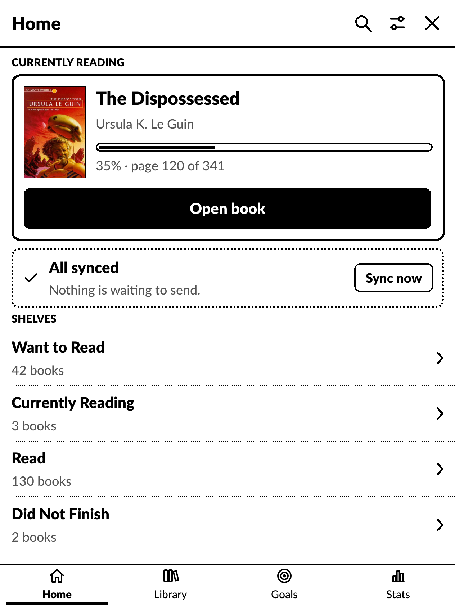 <strong>Home</strong></td>
    <td width="33%" align="center">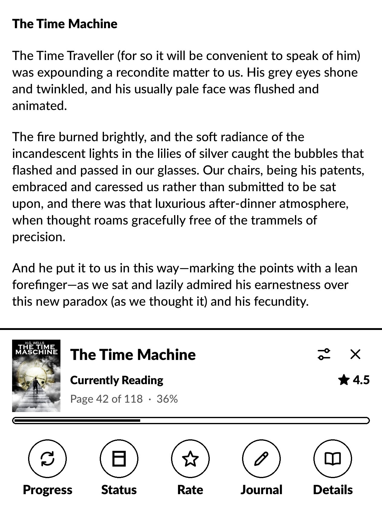 <strong>Reader panel</strong></td>
    <td width="33%" align="center">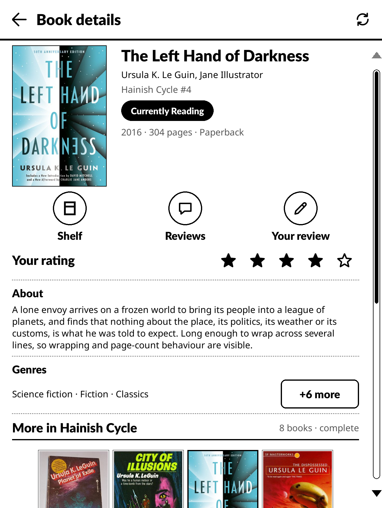 <strong>Book details</strong></td>
  </tr>
  <tr>
    <td align="center">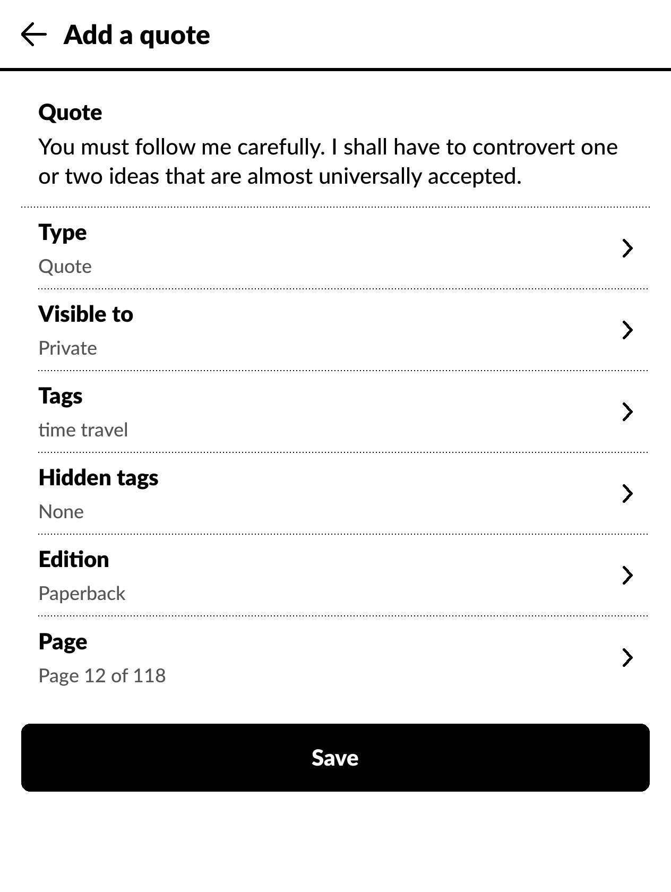 <strong>Save a quote</strong></td>
    <td align="center">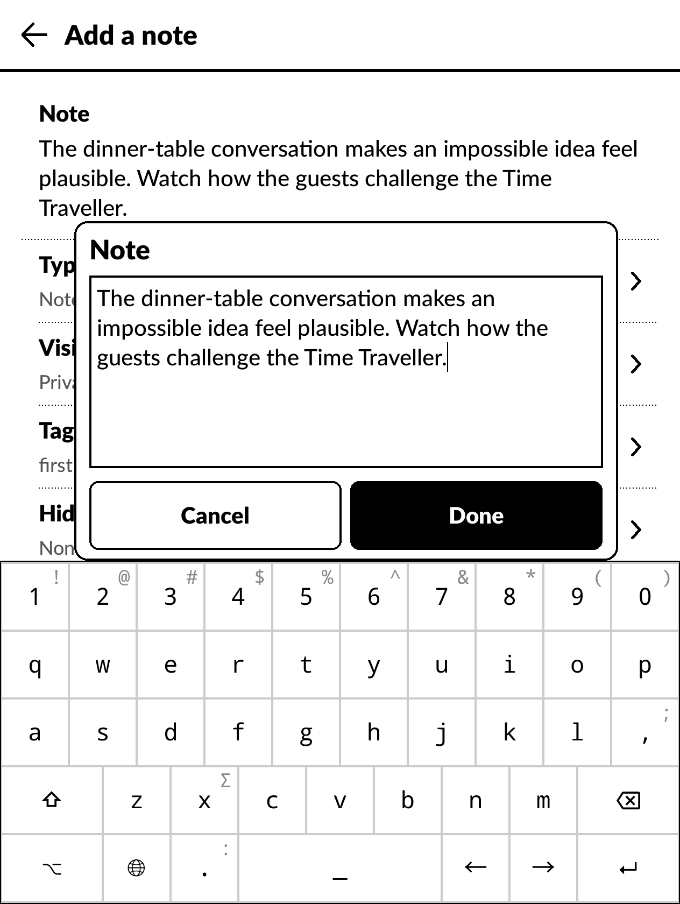 <strong>Write a note</strong></td>
    <td align="center">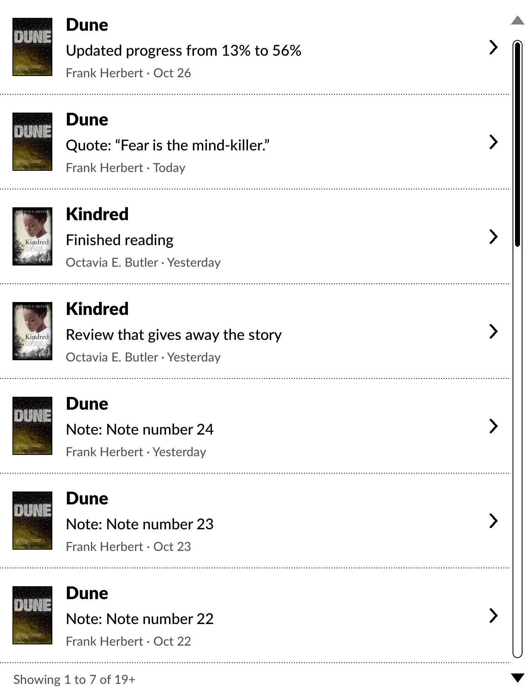 <strong>Journal feed</strong></td>
  </tr>
  <tr>
    <td align="center">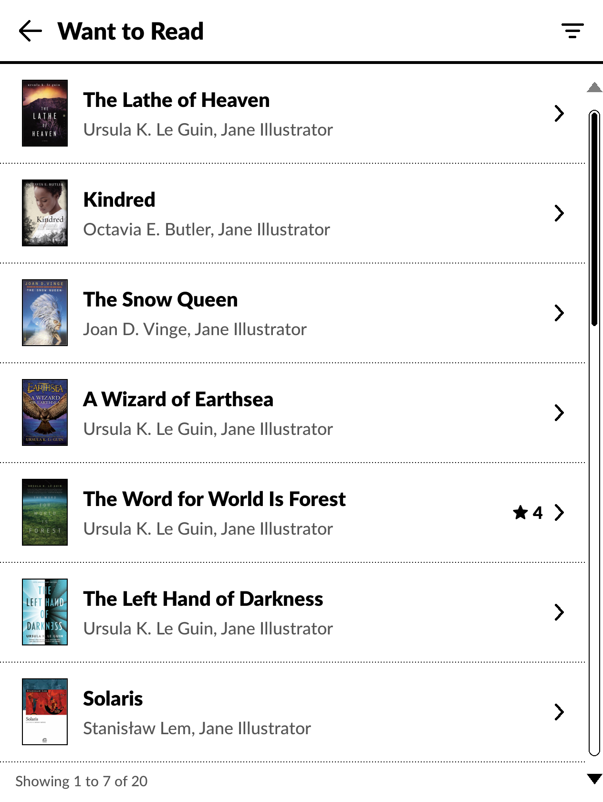 <strong>Shelves</strong></td>
    <td align="center">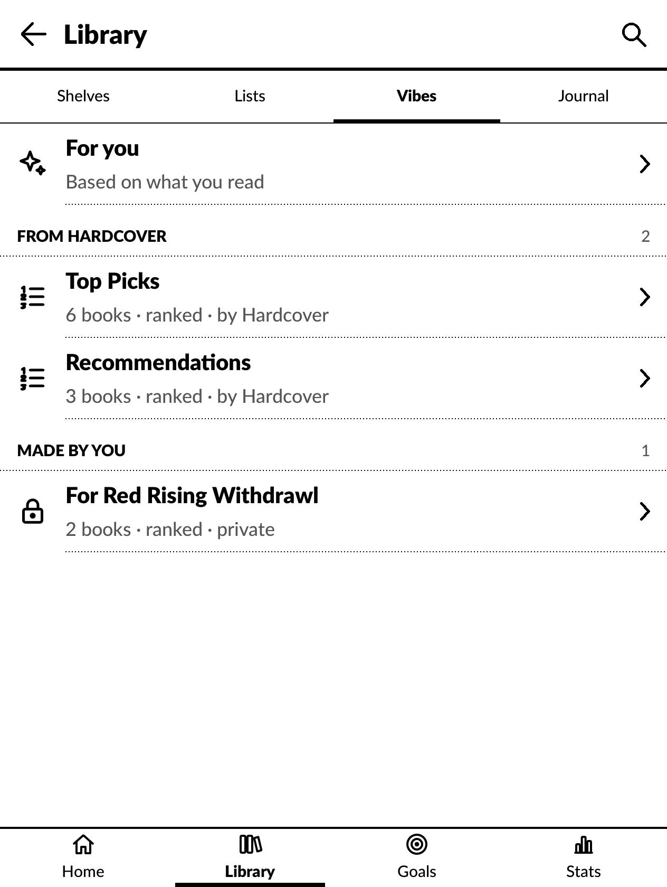 <strong>Vibes</strong></td>
    <td align="center">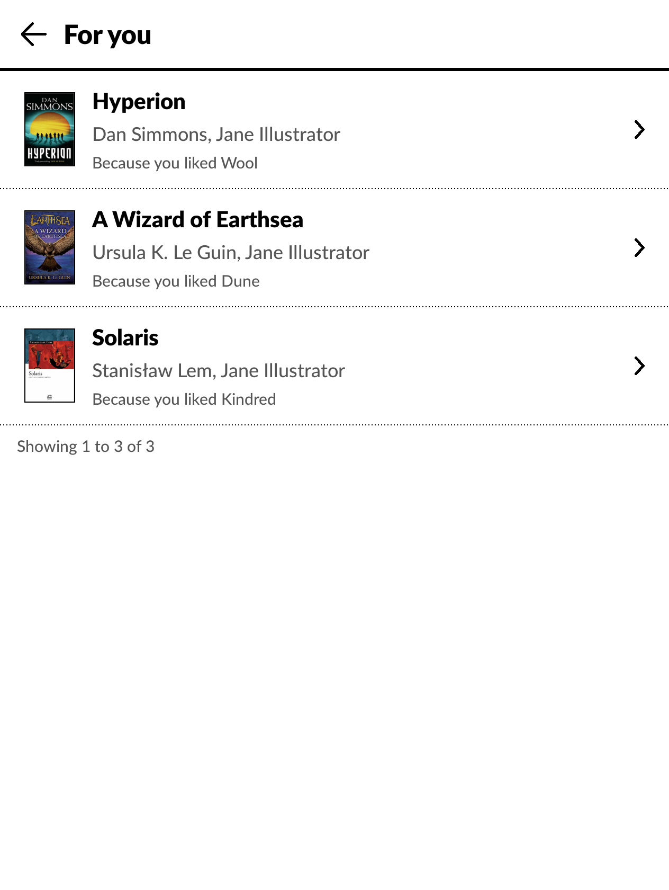 <strong>For you recommendations</strong></td>
  </tr>
  <tr>
    <td align="center">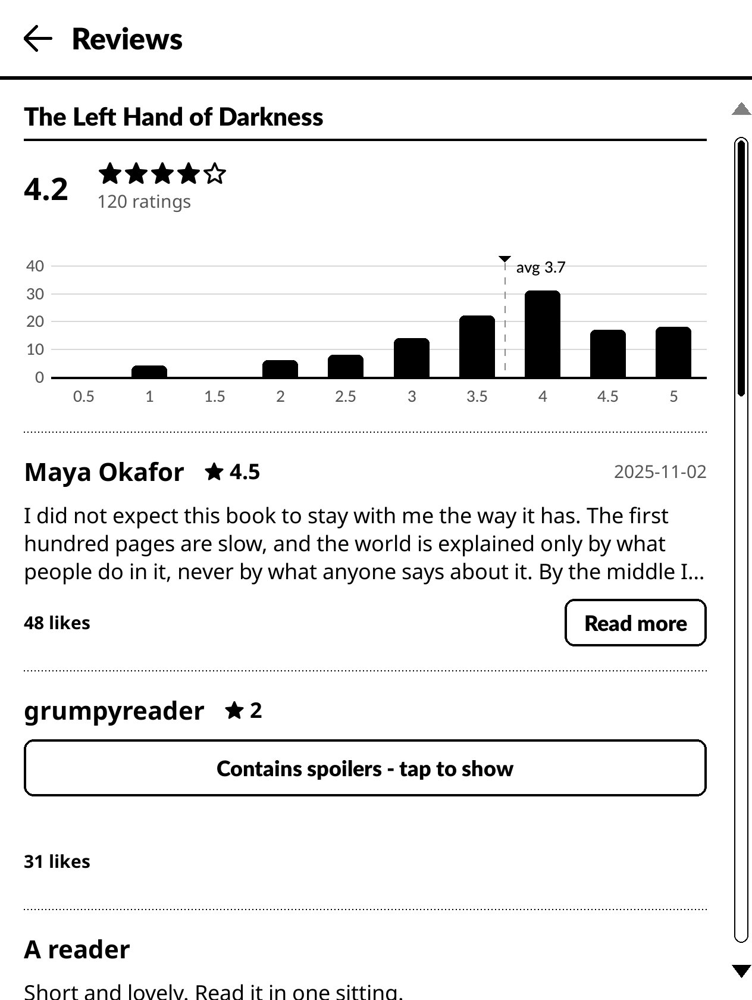 <strong>Community reviews</strong></td>
    <td align="center">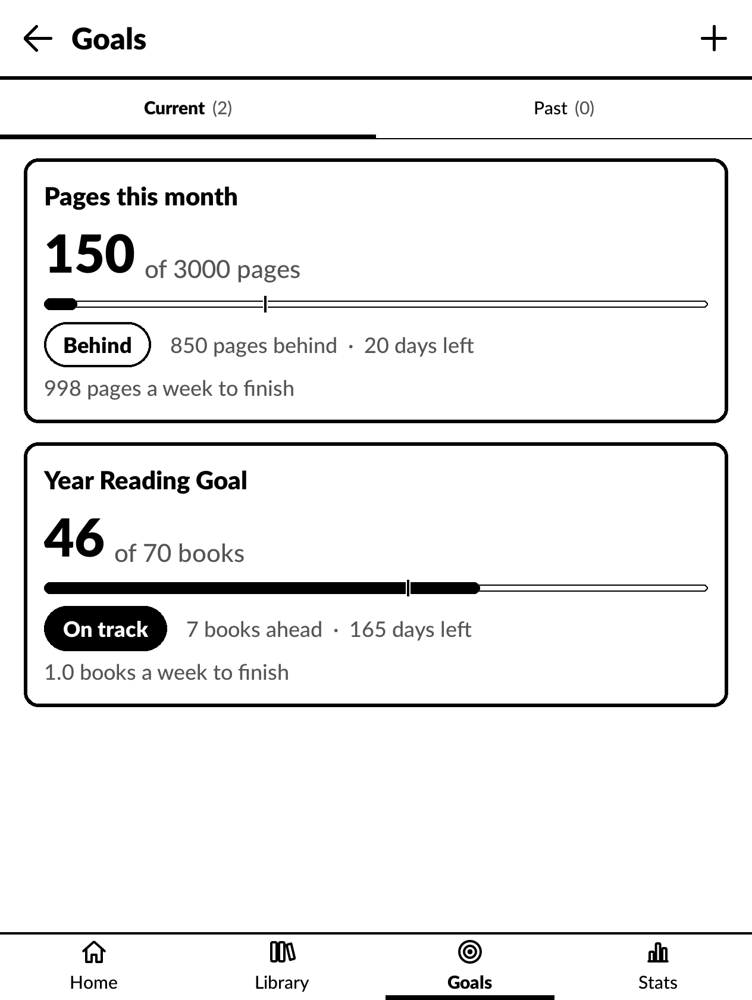 <strong>Reading goals</strong></td>
    <td align="center">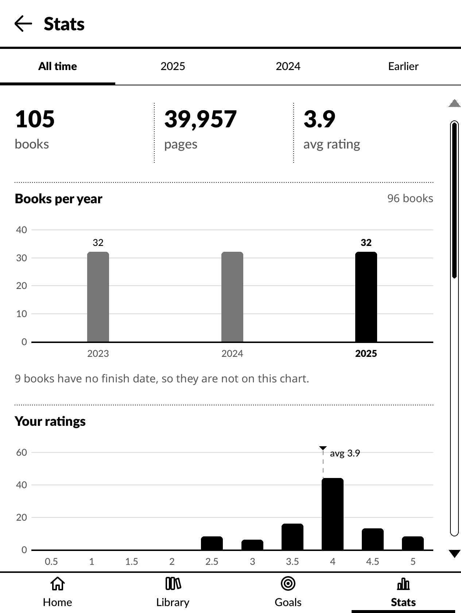 <strong>Reading stats</strong></td>
  </tr>
</table>

*Captured from the current plugin in desktop KOReader at 1264 × 1680, 300 DPI (Kindle Paperwhite size). Real book covers from [Open Library](https://openlibrary.org); sample account data. The reader backdrop uses a public-domain passage from The Time Machine.*

## What you can do

- **Keep Hardcover up to date.** Sync progress automatically or manually, change reading status, and rate books from the reader panel.
- **Browse your library.** Search Hardcover, sort your shelves, explore your own and followed lists, and discover recommendations through Vibes.
- **Save quotes and take notes.** Send highlighted passages to your journal, or write your own reflections with page numbers, tags, and privacy controls. The Journal feed brings them together with progress, finished books, and reviews. Saved entries work offline; new notes, quotes, and edits sync later.
- **Go beyond the cover.** Read synopses and community reviews, explore a series, and manage a book’s shelf and list membership.
- **Keep reading offline.** Progress and library changes queue for later sync. Shelves and lists are saved on-device; browsed reviews stay available offline too. Download covers ahead of time in Settings.
- **Follow your progress.** Create and edit reading goals, check your pace, and explore charts of your reading history, ratings, genres, and authors.

## Install

1. Download **`hardcoversync.koplugin.zip`** from the [latest release](https://github.com/CaptainCamin/HardcoverSync.koplugin/releases/latest).
2. Extract it and copy the **`hardcoversync.koplugin`** folder into KOReader’s `plugins` folder.
3. Restart KOReader.

You can also install through the [KOReader App Store plugin](https://github.com/omer-faruq/appstore.koplugin): search for **Hardcover Sync**. If it is hidden, enable **include zero-star forks** in the App Store settings.

**Switching from the original plugin?** Remove `hardcoverapp.koplugin` first: the two must not be installed together. Your settings carry over.

## Get started

1. In KOReader’s file browser menu, choose **Hardcover** to open Home.
2. Open **Settings → Account → Sign in to Hardcover**. Follow the displayed web address on your phone or computer, enter the code, and approve. No API key or config file needed.
3. Open a book and choose **Hardcover → Link this book** in the reader menu. Search for the matching book and choose an edition if needed.
4. Use **Status** to mark it Currently Reading, then **Progress** to set your position and enable **Track automatically** if you want automatic updates.

Home’s bottom tabs open **Library**, **Goals**, and **Stats**. You can also assign **Hardcover: Home** to a KOReader gesture or quick menu.

Automatic linking by ISBN or Hardcover metadata, batch linking of books on your device, and sync frequency are available in Settings. Progress is mapped to the Hardcover edition’s page count, so page numbers may differ from KOReader’s.

<strong>Advanced: use your own OAuth app or API token</strong>

Copy [`hardcover_config.example.lua`](hardcover_config.example.lua) to `hardcover_config.lua` in the plugin folder. Most users do not need this.

- **Your own OAuth app:** [register a public app](https://hardcover.app/account/developer-apps/new) of type **Mobile, desktop, or CLI**, with **Device Authorization Grant** enabled. Allow `read:catalog read:catalog:search read:me:content read:library read:social write:library`, set `client_id` in the config, then sign in normally. If you change the client ID later, sign out and back in.
- **Personal API token:** get one from [Hardcover’s API settings](https://hardcover.app/account/api), set `token`, and leave `client_id` empty. Keep the file private and replace the token when it expires.

## Development

Run `./spec/run_all.sh` for syntax checks, specs, and harnesses. Render screens with `spec/emu/run.sh`; see the [emulator guide](spec/emu/README.md) for setup and scenarios. Build a release zip with `./spec/package_release.sh`.

## Credits & license

Built on Billiam’s [hardcoverapp.koplugin](https://github.com/Billiam/hardcoverapp.koplugin). Thank you for the original tracking plugin.

Licensed under [AGPL-3.0](LICENSE). The original plugin’s [MIT notice](LICENSE-MIT) is retained for the code inherited from it.
